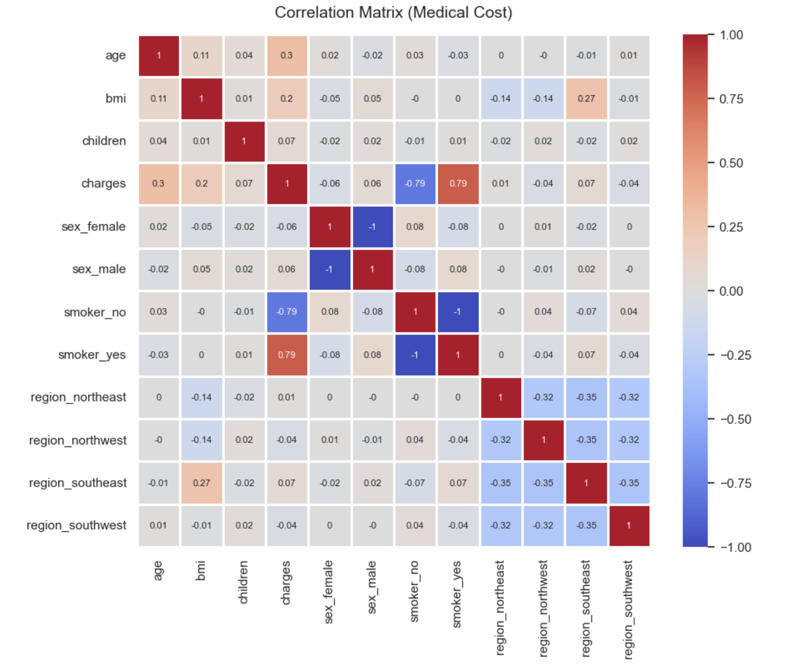
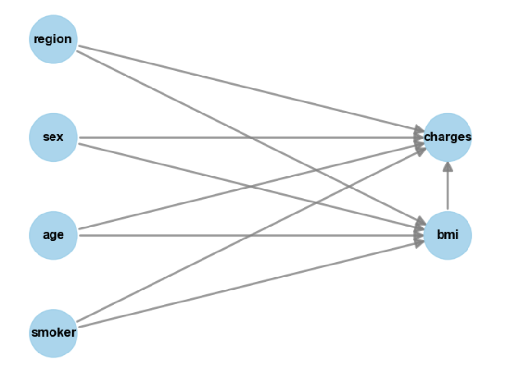
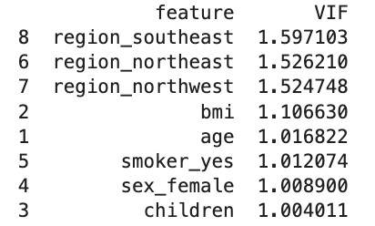
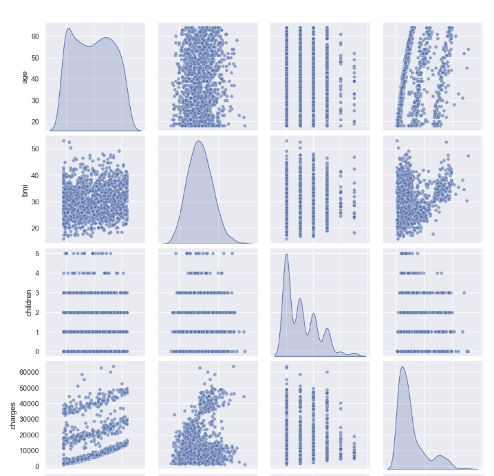

## Overview:
In anticipation of a regression and QSAR (Quantitative Structure–Activity Relationship) related project, this project explores the performance of multiple regression models. From EDA, correlational and causal analysis, to (hyper) parameter tuning and feature elimination, this project builds and tunes multi-linear, polynomial, random forest and XGBoost models. The resulting models all predict the amount of medical charges a patient is to accrue based on various persona, health related metrics.

## Data:
Dataset: https://www.kaggle.com/mirichoi0218/insurance
  
Columns:
* Age: age of primary beneficiary.
* Sex: insurance contractor gender, female, male.
* BMI: Body mass index, providing an understanding of body weights that are relatively high or low relative to height, objective index of body weight (kg / m ^ 2) using the ratio of height to weight, ideally 18.5 to 24.9.
* Children: Number of children covered by health insurance / Number of dependents
* Smoker: Smoking.
* Region: the beneficiary's residential area in the US, northeast, southeast, southwest, northwest.
* Charges: Individual medical costs billed by health insurance.

Column data types: 
* Numerical columns: age, bmi, children and charges.
* Categorical columns: sex, smoker, region.
* The categorical columns are nominal.

Number of rows: 1338

## Libraries:
Kagglehub, pandas, os, numpy, matplotlib, seaborn, statsmodels, sklearn, itertools, xgboost.
  
## Data Cleaning and EDA
### Cleaning: 
No rows needed to be dropped and no cells needed imputing. Sex, smoker and region were all one-hot-encoded.
### Correlational Matrix: 
There is a large correlation between being a smoker (0.79) or not being a smoker (- 0.79) and the total medical charges a patient accrues. Age (0.3) and BMI (0.2) also have an impact on the total charges and are prime features for building the models.  
  
Interestingly, regions like the northeast (- 0.14), northwest (- 0.14) and southeast (0.27) are correlated to BMI. This signals that including regions into the model could cause some multicollinearity.
  
To understand which causes the other (bmi -> region, region -> bmi) we can use doWhy, causal analysis. We can then use VIF (variance inflation factor) to stabilize the feature space and decide which to use for predictive power (ex: bmi vs region) to avoid collinearity.

### DoWhy Causal Analysis:

Age, sex, smoker and region are backdoors/confounders and they impact both BMI and charges.  The causal effect estimate (see EDA notebook) shows that a 1 unit increase in bmi, causes an increase in charges by $340.  Additionally, a high p-value of 0.96, shows that the model is robust.  

### Variance Inflation Factor (VIF):
The VIF results show that none of the features have a high multicollinearity (VIF score > 5), therefore none should be dropped as of yet. The regions have slightly higher VIF scores than their peers. 
  
We know from the doWhy analysis that the regions are cofounders for both bmi and charges. Arguably, there are lifestyle differences in each region that are impacting bmi and also cost of living differences in each region that are impacting charge amounts; among others.  
  
In conclusion, the regions likely carry some predictive power.. Therefore, a parameter sweep that experiments with including or excluding the regions will help determine their impact on the model performance.  

### Pair Plot:
Most of the data is encoded and reveals very little in the pair plot. However, we see three distinct bands in the age vs charges plot, highlighting that there are additional, hidden mechanisms impacting this relationship. 
  
These results suggest that a standard multi-linear model will underperform given that there are hidden feature relationships. However, a polynomial model with engineered features (ex: bmi x smoker x age) could capture these relationships. Furthermore, a random or boosted forest could also capture these relationships from the raw features.
  
Sample plots (see EDA notebook):

Cols: 	  Age -> BMI -> Children -> Charges

## Model Building, Training and Results:
Based on the EDA, model building focused on feature engineering, multi-linear (as a baseline), polynomial, random forest and XGBoost models. (hyper)parameter sweeps and backward selection methods were also used to optimize the model performance. Performance was measured using cross-validation on train and hold-out test sets. Metrics used were RMSE and R^2.

### Feature Engineering:
Initially, columns for bmi_x_smoker and age_x_smoker were created. However, these were essentially multiplying the smoker status (0 or 1) by the other feature and creating little to no signal for the model.   
  
After careful consideration, a unified risk score was created that is the age_bmi_smoker_risk score where being a smoker scales the multiplied bmi_x_age values by another 2.5x. This models the compounding effects of being a smoker, being of a certain age and having a higher bmi.
  
A bmi_x_age feature was created to model the compounding effects of both. This proved helpful, though maybe redundant with the age_bmi_smoker_risk score.
  
Note: Engineered features are for the multi-linear and polynomial models, not the random forest.
  
### Feature Scaling:
All features were scaled to within 10^1 and 10^2:
* Scaled bmi = bmi / 10
* Scaled age = age / 10
* Scale charges = charges / 1000
* Scaled age x bmi x smoker risk  = age_bmi_smoker_risk / 100
* Scaled bmi x age =  bmi_x_age / 100

### Data Split:
* Train size = 80%
* Test size = 20%
( Random state = 42

### Multi-Linear Model:
During EDA, it was established that the relationship between features was mostly non-linear and that a multi-linear model would not be as strong of a fit as a polynomial model. Out of curiosity, this model was created after the polynomial model was trained.   
It uses the best features from the polynomial model (sc = scaled): 
* sc_bmi
* sc_age
* sc_age_bmi_smoker_risk
* sc_bmi_x_age
* smoker_yes
  
Performance Results:  
The model performs nearly as well as the polynomial model. It has an R^2 of 0.7647, a Mean Cross-Validation RMSE of 5.8328 and a Final Test RMSE of 5.5810. Arguably, the features are doing most of the heavy lifting for predicting this amount of variance across the data. 
  
### Polynomial Model:
An initial model was trained with all features available (while omitting the redundant features. Ex: sex_male and sex_female). While the initial model had a slightly higher R^2 of 0.7663, the following features did not have significant p-values: region_northwest, region_southeast, region_southwest, children.
  
Conducting backward elimination by training a new model without these features earned an R^2 of 0.7650. Its sex_female feature did not have a significant p-value and was dropped on the next iteration.
  
The final model had highly significant features consisting of sc_bmi, sc_age, sc_age_bmi_smoker_risk, sc_bmi_x_age, smoker_yes with an R^2 of 0.7650. This model conserves the majority of the initial variance captured with the larger feature set.
 
The final formula is: 
sc_charges ~ sc_bmi + np.power(sc_age, 2) + np.power(sc_age_bmi_smoker_risk, 3) + np.power(sc_bmi_x_age, 4) + np.power(smoker_yes, 5)
  
Performance Results:  
The Mean Cross-Validation RMSE is 5.8248 and the Final Test RMSE is 5.5587. Since both of these numbers are close to one another, the model generalizes well to unseen data!  The model did not overfit to the training data and learned the underlying pattern and variance of the data up to an R^2 of 0.7650.
  
The pairplot helped the most in discovering a hidden relationship between charges and age, which was subsequently modeled through the engineered features sc_age_bmi_smoker_risk and sc_bmi_x_age.
  
### Random Forest:
Two hyperparameter grid sweeps were conducted to fine tune the model:
  
First Sweep: 
* 'n_estimators': [10, 20, 40, 80, 160],
* 'max_depth': [4, 6, 8, None],
* 'min_samples_split': [2, 4, 8, 16],
* 'max_features': [1.0, 'sqrt']
  
Best Parameter Set: {'max_depth': 4, 'max_features': 1.0, 'min_samples_split': 4, 'n_estimators': 20}
  
The model attained a much lower mean cross-validation RMSE of 4.5346! A fine tune, second hyperparameter sweep was conducted.
  
Second Sweep:
* 'n_estimators': [18, 19, 20, 21, 22],
* 'max_depth': [3, 4, 5],
* 'min_samples_split': [3, 4, 5],
* 'max_features': [1.0, 'sqrt']
  
Best Parameter Set: {'max_depth': 4, 'max_features': 1.0, 'min_samples_split': 3, 'n_estimators': 22}
  
Performance Results:  
The model leverages all features including regions to deliver a final test RMSE of 4.5295 and a final test R^2: 0.8679. The model captures the most signal from the data and has the best performance metrics yet!
  
### XGBoost:
A final XGBoost model was trained to see if more performance could be squeezed out of the data. Two hyperparameter grid sweeps were conducted to fine tune the model:
  
First Sweep: 
* 'n_estimators': [10, 20, 40, 80, 160],
* 'learning_rate': [0.01, 0.03, 0.05, 0.1, 0.2],
* 'max_depth': [4, 6, 8],
* 'reg_alpha': [0, 0.1, 0.5, 1.0],
* 'reg_lambda': [1.0, 3.0, 5.0, 10]
  
Best Parameter Set: {'learning_rate': 0.1, 'max_depth': 4, 'n_estimators': 40, 'reg_alpha': 1.0, 'reg_lambda': 3.0}
Best Mean CV RMSE: 4.5542
  
Second Sweep: 
* 'n_estimators': [35, 40, 45],
* 'learning_rate': [0.09, 0.1, 0.11, 0.12],
* 'max_depth': [3, 4, 5],
* 'reg_alpha': [0.9, 1.0, 1.1, 1.2],
* 'reg_lambda': [2.0, 3.0, 4.0]
  
Best Parameter Set: {'learning_rate': 0.11, 'max_depth': 3, 'n_estimators': 35, 'reg_alpha': 1.0, 'reg_lambda': 2.0}
Best Mean CV RMSE: 4.5085
  
Performance Results:
The model was able to squeeze out a bit more performance from the features by minimizing the loss on the residuals of previous decision tree iterations. The model has a final test RMSE of 4.2768 and a final test R^2 of 0.8822.

## Discussion:

| Metric  | Multi-Linear | Polynomial | Random Forest | XGBoost |
| ------  | ------------ | ---------- | ------------ | ------- |
|R^2      |0.7647        |0.7650      |0.8679        |0.8822   |
|Test RMSE|5.5810        |5.5587      |4.5295        |4.2768   |
  
The initial multi-linear model performed better than expected, capturing the majority of the variance in the data up to an R^2 of 0.7647. It used the best features from the parameter sweep done for the polynomial model and was built after the polynomial model.  
  
Interestingly, exponentiating the feature values in the polynomial model provides a very minimal performance boost compared to the multi-linear model. On the other hand, the engineering features captured most of the variance as demonstrated during the parameter sweep and backward elimination process used in training this model.  
  
The random forest model provided a massive performance boost over the previous two models, reducing the Test RMSE score by 18.5% and capturing even more variance up to an R^2 of 0.8679. Its bagging mechanism averages multiple decision trees to eliminate variance and carve out decision boundaries. This proved quite powerful over the multi-band pattern seen in the age vs charges pair plot.  
  
Finally, from minimizing the gradient loss in between training iterations, the XGBoost model squeezed out a bit more performance from the data, improving both the R^2 and RMSE values.  
  
With more time, I would have liked engineering more features or removing features in the forest models to see their impact on the overall performance. I’m happy with the results and look forward to leveraging this pipeline in feature projects. 
